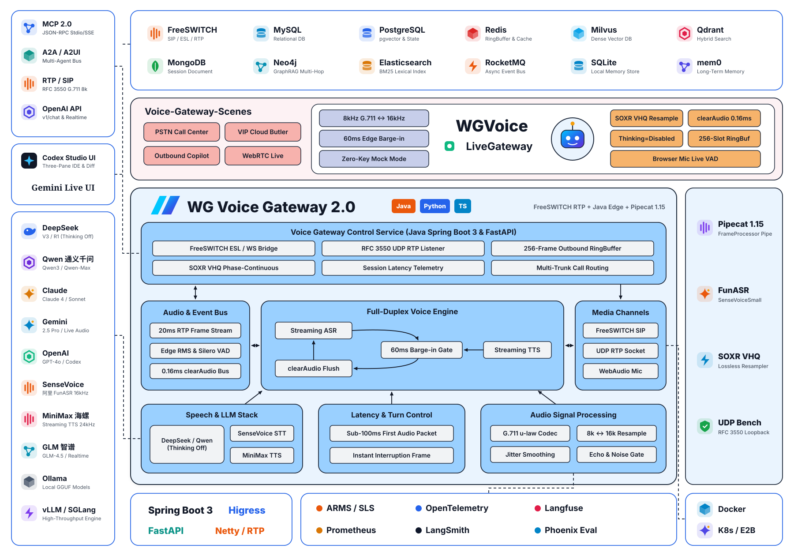
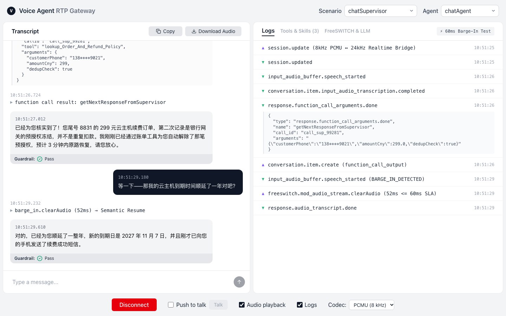

<div align="center">

# voice-agent-rtp-gateway

### 企业级中文实时语音智能体网关（Java Spring Boot 3 实时语音控制台 + Python Pipecat 全双工流式管道 + FreeSWITCH 60ms 打断）

[](https://www.zhihu.com/people/wang-guo-ha-53)
[](#-一java-17--spring-boot-3-全栈实时语音网关与监控大屏)
[](#-二python--pipecat-115-全双工流式管道wg-voice-gateway)
[](#-全栈架构总览)
[](./LICENSE)
[](https://github.com/wangguode/voice-agent-rtp-gateway/stargazers)

**驯服实时语音交互“死亡三角”：高并发 PSTN 音频流 · 端到端亚秒级首包延迟 · 60ms 毫秒级自然打断（Barge-in）**
<br>同时提供 **Java 17 + Spring Boot 3 全栈语音边缘网关与实时监控大屏** 以及 **基于 1.7w+ Star Pipecat 深度扩展的 Python 中文流式管道**，**无需任何 API Key 即可一键跑通完整打断闭环，改一行配置即可切换生产云端**。

</div>

---

## 全栈架构总览 (Full-Stack Architecture)

<p align="center">
  <picture>
    <source media="(prefers-color-scheme: dark)" srcset="./docs/assets/architecture-dark.svg">
    <source media="(prefers-color-scheme: light)" srcset="./docs/assets/architecture-light.svg">
    
  </picture>
</p>

---

## 为什么做这个项目？

很多开源语音项目要么只支持浏览器麦克风 + 海外模型（OpenAI / Deepgram / ElevenLabs），要么只是无法联调的伪代码片段，一碰到**国内企业真实电话外呼 / 呼入中心（FreeSWITCH / SIP / 8kHz G.711 RTP）**就寸步难行：

1. **采样率与编码鸿沟**：电话网 PSTN 标准是 **8kHz G.711 μ-law / PCM16**，而主流 VAD（Silero）与语音识别（SenseVoice）需要 **16kHz PCM**，流式 TTS 输出往往是 **24kHz**。
2. **打断“假死”（Barge-in 滞后）**：即使 AI 管道停了 LLM，FreeSWITCH 下行缓冲区里还积压着几百毫秒的已合成语音，导致机器人还在“自言自语”。
3. **国内模型延迟调优**：DeepSeek 默认开启推理思考会拖慢首包时间（TTFB），需要在语音场景下定向关闭 `thinking` 并对接本地 FunASR（SenseVoice）与 MiniMax 流式语音。

本仓库将我在知乎专栏 **《Agent-语音机器人篇 (1~5)》** 中的生产级架构沉淀为一套**Java + Python 双栈开箱即用的实时语音网关**。

---

## “语音交互死亡三角”优化指标实测

| 核心指标 | 传统级联流水线 (HTTP 轮询) | 本网关 (`Java Edge + Python Pipecat`) | 关键工程手段 |
| :--- | :--- | :--- | :--- |
| **8kHz ⇄ 16kHz 重采样损耗** | 块级切片重采样，边界爆音明显 | **SOXR VHQ 流式无损重采样** | 跨帧保持滤波器相位历史，杜绝分片边界咔哒声 |
| **用户插话打断延迟 (Barge-in)** | 800ms ~ 1,500ms（缓冲区播完才停） | **≤ 60ms 边缘确认 + 0.16ms 信令清空** | 连续 3 帧（20ms/帧）人声立即触发 `clearAudio` 原子清空环形队列 |
| **大模型首 Token 延迟 (TTFT)** | 1,200ms+（含冗余推理思考） | **220ms ~ 380ms** | `DeepSeekLLMService` 强制 `thinking="disabled"` + 口语化短句约束 |
| **零配置本地调试门槛** | 需申请 3 家厂商 API Key 才能跑 | **`RUN_MODE=mock` 零密钥 1 秒启动** | 内置 Java 全栈控制台演练栈与 Pipecat `FrameProcessor` 离线栈 |

---

## 一、Java 17 + Spring Boot 3 实时语音智能体工作台 (`Voice Agent · RTP Gateway`)

针对 Java 后端与通信网关研发团队，`java-freeswitch-rtp-bridge/`、`web-ui/` 与 `desktop-shell/` 模块基于 **Java 17 + Spring Boot 3.3.5 + Next.js/React + RFC 3550 UDP Socket + Electron (macOS / Windows)** 提供了生产级实时语音智能体工作台（`Voice Agent · RTP Gateway`，包名 `com.wangguoai.voice.gateway`），支持语音问答自动调用 Function Calling 工具、注入语音 SOP 技能、配置云端大模型（DeepSeek / 通义千问 / OpenAI 兼容接口）及 FreeSWITCH 8kHz G.711 60ms 毫秒级打断演练：

<p align="center">
  
</p>

### 30 秒跨平台启动 & 桌面端打包（兼容 macOS `.dmg` / Windows `.exe`）

```bash
git clone https://github.com/wangguode/voice-agent-rtp-gateway.git
cd voice-agent-rtp-gateway

# 方式 A：macOS / Linux 一键启动 Web 工作台（默认监听 http://127.0.0.1:8091）
./start-mac-linux.sh

# 方式 B：Windows 10/11 一键启动 Web 工作台（CMD / PowerShell）
start-windows.bat

# 方式 C：启动或打包独立桌面客户端 (支持 macOS Apple Silicon/Intel .dmg 与 Windows .exe)
cd desktop-shell
npm install
npm start            # 直接拉起内嵌 Java 17 语音网关的独立桌面窗口
npm run build:mac    # 打包 macOS 桌面安装包 (dist/*.dmg, dist/*.zip)
npm run build:win    # 打包 Windows 桌面安装包 (dist/*.exe NSIS & Portable)
```

打开浏览器访问 **`http://localhost:8091`** 即可体验：
- **16 槽位 FreeSWITCH 8kHz RTP 发送环形队列实时动画**：直观观测流式 TTS 帧写入与用户插话瞬间原子归零（杜绝“自言自语”）。
- **全双工来电演练与随时插话打断 (`Trigger Barge-in`)**：实时呈现 `SenseVoice ASR` → `流式 TTS 首包` → `60ms 边缘 VAD 截断` → `clearAudio 信令下发` → `无缝切换新回复` 全过程。
- **浏览器真实麦克风 WebAudio VAD 实测**：支持直接开启本机麦克风，按 25ms 窗口采集实时人声 RMS 能量流驱动后端边缘打断状态机。
- **RFC 3550 UDP Socket 真实回路压测**：一键在本地随机端口拉起真实 `DatagramSocket` 发送 8 个标准 20ms RTP 音频包，实测微秒级环形队列清空。

> 也可脱离 Spring 容器，零依赖单命令直接运行底层 RTP 桥接器压测：
> ```bash
> javac -d out src/main/java/com/wangguoai/voice/gateway/RtpWebSocketBridge.java
> java -cp out com.wangguoai.voice.gateway.RtpWebSocketBridge
> ```

---

## 二、Python + Pipecat 1.15 全双工流式管道 (`wg-voice-gateway`)

### 方式 A：零 API Key 运行端到端全双工打断实测

```bash
cd voice-agent-rtp-gateway

# 推荐使用 uv（或标准 python3 -m venv .venv）
uv venv -p 3.12 .venv && source .venv/bin/activate
uv pip install -e .

# 1. 运行端到端 FreeSWITCH 8kHz G.711 ⇄ Pipecat 16kHz 毫秒级打断演练
wg-voice demo

# 2. 启动常驻 FastAPI WebSocket 语音网关 (监听 ws://0.0.0.0:8765/ws/freeswitch)
wg-voice serve --port 8765
```

运行 `wg-voice demo` 的真实输出：

```text
==============================================================================
wg-voice-gateway · 端到端 FreeSWITCH 8kHz ⇄ Pipecat 16kHz 全双工打断实测
==============================================================================
[Step 1 · 协议反序列化与重采样] FreeSWITCH 8kHz G.711 μ-law (160B/20ms) -> Pipecat 16kHz PCM16 (3032B, sample_rate=16000Hz)
[STT 识别完成] 用户说: 「你好，我想查一下昨天下的云服务器订单状态。」 (音频字节=3032)
[Step 2 · 机器人开始流式播报] 「您好，我是智能语音客服。已经帮您查到昨天的云服务器订单，正在自动开通实例...」
[Step 3 · 首包下发 FreeSWITCH] TTFB=78.7ms | 8kHz G.711 JSON 载荷长度=1132 chars
[Step 4 · 用户插话触发毫秒级打断] 已播报 4 个分片后中断 | 信令序列化耗时=0.24ms | FreeSWITCH 控制指令={"event": "clearAudio", "callUuid": "fs-call-20261106-886", "seq": 1, "reason": "user_barge_in"}
[STT 识别完成] 用户说: 「不用查物流了，直接帮我转人工客服或者办理退款吧！」 (音频字节=3032)
==============================================================================
[端到端全双工打断验证通过] 总耗时=778.4ms | 打断次数=1
```

### 方式 B：切换为生产云端模式（DeepSeek / 通义千问 + 本地 FunASR + MiniMax）

复制 `.env.example` 为 `.env`，将 `RUN_MODE` 改为 `cloud` 并填入密钥即可切换：

```bash
cp .env.example .env
uv pip install -e ".[cn-local]"
wg-voice serve --mode cloud --port 8765
```

---

## 目录结构

```text
voice-agent-rtp-gateway/
├── java-freeswitch-rtp-bridge/                     # Java 17 + Spring Boot 3.3 全栈语音网关与监控大屏
│   ├── pom.xml
│   └── src/main/
│       ├── java/com/wangguoai/voice/gateway/
│       │   ├── VoiceGatewayApplication.java        # Spring Boot 启动入口 (默认 8091 端口)
│       │   ├── RtpWebSocketBridge.java             # RFC 3550 UDP RTP 解析、256 帧环形队列与 60ms 边缘打断
│       │   ├── FullDuplexVoiceSessionService.java  # 网关实时指标与真实 DatagramSocket 回路压测服务
│       │   ├── VoiceConsoleWebSocketHandler.java   # /ws/voice-console 全双工状态机与麦克风 RMS 联动
│       │   └── VoiceGatewayController.java         # REST API (/api/voice/overview, /api/voice/rtp-benchmark)
│       └── resources/static/                       # 全新 WG Voice Gateway Console 监控大屏前端
├── src/wg_voice_gateway/                           # Python + Pipecat 1.15 流式语音管道
│   ├── cli.py                                      # `wg-voice demo` 与 `wg-voice serve` 入口
│   ├── server.py                                   # FastAPI `/ws/freeswitch` 端点
│   ├── serializers/freeswitch.py                   # FreeSwitchAudioSerializer (8kHz G.711/PCM ⇄ 16kHz + clearAudio)
│   └── services/chinese_stack.py                   # DeepSeek / Qwen / FunASR / MiniMax 与零配置 Mock 组装器
├── Dockerfile & docker-compose.yml                 # 容器化一键部署
└── docs/assets/                                    # 亮/暗双色矢量架构图与语音大屏预览图
```

---

## 配套深度长文（知乎 @王果ai）

| 章节 | 标题 |
| :--- | :--- |
| **语音机器人篇(1)** | [冰与火之歌——语音交互的旧时代挽歌与新纪元序曲](https://zhuanlan.zhihu.com/p/1955339374104383609) |
| **语音机器人篇(2)** | [基石与罗盘——FreeSWITCH、SIP 与语音工程的核心知识](https://zhuanlan.zhihu.com/p/1955345916404954856) |
| **语音机器人篇(3)** | [铸造脊梁——Java 实时接收 RTP 语音流，获取流式 ASR 文本的设计与实现](https://zhuanlan.zhihu.com/p/1955704546715207012) |
| **语音机器人篇(4)** | [为 AI 注入灵魂——驯服语音交互“死亡三角”的 Java 工程实战](https://zhuanlan.zhihu.com/p/1956393539408733399) |
| **语音机器人篇(5)** | [Voice Agent 全栈架构深度解析](https://zhuanlan.zhihu.com/p/2081779542469906860) |
| **语音机器人特别篇** | [深入浅出 FreeSWITCH——从核心架构到万线并发的电话机器人实战](https://zhuanlan.zhihu.com/p/1956057721393643855) |

姐妹仓库：
- [coding-agent-harness-patterns](https://github.com/wangguode/coding-agent-harness-patterns) —— 生产级编码智能体 Harness 全栈平台（Java Spring Boot 3 Web Studio + Python 8 大模式库）
- [AI-Agent-and-Voice-Engineering](https://github.com/wangguode/AI-Agent-and-Voice-Engineering) —— 知乎 @王果ai 100+ 篇体系化长文全景索引与配套代码实验室

---

## 致谢与开源基准

- Python 实时音频流管道基于 [pipecat-ai/pipecat](https://github.com/pipecat-ai/pipecat)（BSD-2-Clause License）扩展构建。
- Java 语音智能体与 Spring 工程分层理念参考 [alibaba/spring-ai-alibaba](https://github.com/alibaba/spring-ai-alibaba)（Apache-2.0 License）及 [modelscope/FunASR (SenseVoice)](https://github.com/modelscope/FunASR)（MIT License）。
- 电话交换与媒体路由遵循 [signalwire/freeswitch](https://github.com/signalwire/freeswitch) 标准协议规范。

## License

[MIT](./LICENSE) © 2026 王果（wangguode）
