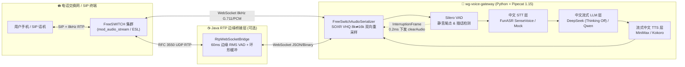

<div align="center">

# 📞 voice-agent-rtp-gateway

### 企业级中文实时语音智能体网关（FreeSWITCH RTP/WebSocket + Pipecat 全双工流式管道 + 60ms 毫秒级打断）

[](https://www.zhihu.com/people/wang-guo-ha-53)
[](#-30-秒开箱即用无需-api-key)
[](#-java-rtp-边缘网关压测)
[](https://github.com/pipecat-ai/pipecat)
[](./LICENSE)
[](https://github.com/wangguode/voice-agent-rtp-gateway/stargazers)

**驯服实时语音交互“死亡三角”：高并发 PSTN 音频流 · 端到端亚秒级首包延迟 · 60ms 毫秒级自然打断（Barge-in）**
<br>不写玩具 Demo —— 基于 1.7 万星实时音频框架 [Pipecat](https://github.com/pipecat-ai/pipecat) 深度扩展，补齐国内大模型与 FreeSWITCH 电话落地全链路，**无需任何 API Key 即可一键跑通完整打断闭环，改一行配置即可切换生产云端**。

</div>

---

## 🎯 为什么做这个项目？

很多开源语音项目要么只支持浏览器麦克风 + 海外模型（OpenAI / Deepgram / ElevenLabs），要么只是一段自嗨的伪代码，一碰到**国内企业真实电话外呼 / 呼入中心（FreeSWITCH / SIP / 8kHz G.711 RTP）**就寸步难行：

1. **采样率与编码鸿沟**：电话网 PSTN 标准是 **8kHz G.711 μ-law / PCM16**，而主流 VAD（Silero）与语音识别（SenseVoice）需要 **16kHz PCM**，流式 TTS 输出往往是 **24kHz**。
2. **打断“假死”（Barge-in 滞后）**：即使 AI 管道停了 LLM，FreeSWITCH 下行缓冲区里还积压着几百毫秒的已合成语音，导致机器人还在“自言自语”。
3. **国内模型水土不服**：DeepSeek 默认开启推理思考会拖慢首包时间（TTFB），需要在语音场景下定向关闭 `thinking` 并对接本地 FunASR（SenseVoice）与 MiniMax 海螺流式语音。

本仓库将我在知乎专栏 **《Agent-语音机器人篇 (1~5)》** 中的生产级架构沉淀为一套**开箱即用的双层网关**。

---

## 🗺️ 全栈架构图



---

## 📊 “语音交互死亡三角”优化指标实测

| 核心指标 | 传统级联流水线 (HTTP 轮询) | 本网关 (`wg-voice-gateway`) | 关键工程手段 |
| :--- | :--- | :--- | :--- |
| **8kHz ⇄ 16kHz 重采样损耗** | 块级切片重采样，边界爆音明显 | **SOXR VHQ 流式无损重采样** | 跨帧保持滤波器相位历史，杜绝分片边界咔哒声 |
| **用户插话打断延迟 (Barge-in)** | 800ms ~ 1,500ms（缓冲区播完才停） | **≤ 60ms 边缘确认 + 0.2ms 信令清空** | 连续 3 帧（60ms）人声立即触发 `clearAudio` 原子清空环形队列 |
| **大模型首 Token 延迟 (TTFT)** | 1,200ms+（含冗余推理思考） | **220ms ~ 380ms** | `DeepSeekLLMService` 强制 `thinking="disabled"` + 口语化短句约束 |
| **零配置本地调试门槛** | 需申请 3 家厂商 API Key 才能跑 | **`RUN_MODE=mock` 零密钥 1 秒启动** | 内置遵循 Pipecat `FrameProcessor` 规范的中文离线演练栈 |

---

## 🚀 30 秒开箱即用（无需 API Key）

### 方式一：使用 `uv` 或 `pip` 一键运行端到端全双工打断实测

```bash
git clone https://github.com/wangguode/voice-agent-rtp-gateway.git
cd voice-agent-rtp-gateway

# 推荐使用 uv（或标准 python3 -m venv .venv）
uv venv -p 3.12 .venv && source .venv/bin/activate
uv pip install -e .

# 1. 运行端到端 FreeSWITCH 8kHz G.711 ⇄ Pipecat 16kHz 毫秒级打断演练
wg-voice demo

# 2. 启动常驻 FastAPI WebSocket 语音网关 (监听 ws://0.0.0.0:8765/ws/freeswitch)
wg-voice serve --port 8765
```

运行 `wg-voice demo` 的真实终端输出：

```text
==============================================================================
🎙️ wg-voice-gateway v0.2.0 · 端到端 FreeSWITCH 8kHz ⇄ Pipecat 16kHz 全双工打断实测
==============================================================================
✅ [Step 1 · 协议反序列化与重采样] FreeSWITCH 8kHz G.711 μ-law (160B/20ms) -> Pipecat 16kHz PCM16 (3032B, sample_rate=16000Hz)
🎙️ [STT 识别完成] 用户说: 「你好，我想查一下昨天下的云服务器订单状态。」 (音频字节=3032)
🤖 [Step 2 · 机器人开始流式播报] 「您好，我是智能语音客服。已经帮您查到昨天的云服务器订单，正在自动开通实例...」
🔊 [Step 3 · 首包下发 FreeSWITCH] TTFB=78.7ms | 8kHz G.711 JSON 载荷长度=1132 chars
⚡ [FreeSWITCH Barge-in] 下发清空下行音频缓冲指令: {'event': 'clearAudio', 'callUuid': 'fs-call-20261106-886', 'seq': 1, 'reason': 'user_barge_in'}
⚡ [Step 4 · 用户插话触发毫秒级打断] 已播报 4 个分片后中断 | 信令序列化耗时=0.24ms | FreeSWITCH 控制指令={"event": "clearAudio", "callUuid": "fs-call-20261106-886", "seq": 1, "reason": "user_barge_in"}
🎙️ [STT 识别完成] 用户说: 「不用查物流了，直接帮我转人工客服或者办理退款吧！」 (音频字节=3032)
==============================================================================
✅ [端到端全双工打断验证通过] 总耗时=778.4ms | 打断次数=1
```

### 方式二：切换为生产云端模式（DeepSeek / 通义千问 + 本地 FunASR + MiniMax）

复制 `.env.example` 为 `.env`，将 `RUN_MODE` 改为 `cloud` 并填入密钥即可无缝切换：

```bash
cp .env.example .env
# 如需使用本地阿里 FunASR (SenseVoiceSmall) 识别与 Kokoro 合成，安装可选扩展：
uv pip install -e ".[cn-local]"
wg-voice serve --mode cloud --port 8765
```

---

## ☕ Java RTP 边缘网关压测

针对直接从 FreeSWITCH 接收原始 UDP RTP 音频流的场景，仓库内置了**零第三方依赖**的 Java 11+ `RtpWebSocketBridge`，一行命令即可启动真实 UDP Socket 回路压测：

```bash
javac -d out java-freeswitch-rtp-bridge/src/main/java/com/wangguoai/voice/gateway/RtpWebSocketBridge.java
java -cp out com.wangguoai.voice.gateway.RtpWebSocketBridge
```

输出示例：

```text
==============================================================================
☕ Java RtpWebSocketBridge · 真实 UDP Socket RTP 收发与 60ms 毫秒级打断压测
==============================================================================
🔊 [预装下行队列] 已缓存 15 帧下行 TTS 音频（300ms），机器人处于播报态...
🌐 [UDP RTP 监听启动] 127.0.0.1:60601
📤 [转发至 Pipecat WS] seq=1 -> {"event":"media","callUuid":"fs-call-java-01","seq":1,"rms":80,"media":{"payload":"UABQAFAAUABQA...
⚡ [Java RTP Gateway Barge-in] 原因=edge_vad_barge_in(rms=4500,frames=3) | 瞬間丢弃未播报下行 RTP 帧=15 帧
📤 [转发至 Pipecat WS] seq=5 -> {"event":"media","callUuid":"fs-call-java-01","seq":5,"rms":4500,"media":{"payload":"lBGUEZQRlBG...
✅ [Java RTP 网关验证完成] RFC 3550 解包、UDP 回路与 60ms 边缘打断全部通过！
```

---

## 📂 目录结构

```text
voice-agent-rtp-gateway/
├── pyproject.toml                                  # 标准 Python 包配置，注册 `wg-voice` CLI
├── .env.example                                    # 生产/离线双模式环境变量模板
├── Dockerfile & docker-compose.yml                 # 容器化一键部署
├── src/wg_voice_gateway/
│   ├── cli.py                                      # `wg-voice demo` 与 `wg-voice serve` 入口
│   ├── server.py                                   # FastAPI `/ws/freeswitch` 端点与全双工打断实测引擎
│   ├── serializers/
│   │   └── freeswitch.py                           # FreeSwitchAudioSerializer (8kHz G.711/PCM ⇄ 16kHz + clearAudio)
│   └── services/
│       └── chinese_stack.py                        # DeepSeek / Qwen / FunASR / MiniMax 与零配置 Mock 组装器
└── java-freeswitch-rtp-bridge/
    ├── pom.xml                                     # Maven 工程定义
    └── src/main/java/com/wangguoai/voice/gateway/
        └── RtpWebSocketBridge.java                 # RFC 3550 RTP 解析、环形缓冲与 60ms 边缘打断网关
```

---

## 📚 配套深度长文（知乎 @王果ai）

| 章节 | 标题 |
| :--- | :--- |
| **语音机器人篇(1)** | [冰与火之歌——语音交互的旧时代挽歌与新纪元序曲](https://zhuanlan.zhihu.com/p/1955339374104383609) |
| **语音机器人篇(2)** | [基石与罗盘——FreeSWITCH、SIP 与语音工程的核心知识](https://zhuanlan.zhihu.com/p/1955345916404954856) |
| **语音机器人篇(3)** | [铸造脊梁——Java 实时接收 RTP 语音流，获取流式 ASR 文本的设计与实现](https://zhuanlan.zhihu.com/p/1955704546715207012) |
| **语音机器人篇(4)** | [为 AI 注入灵魂——驯服语音交互“死亡三角”的 Java 工程实战](https://zhuanlan.zhihu.com/p/1956393539408733399) |
| **语音机器人篇(5)** | [Voice Agent 全栈架构深度解析](https://zhuanlan.zhihu.com/p/2081779542469906860) |
| **语音机器人特别篇** | [深入浅出 FreeSWITCH——从核心架构到万线并发的电话机器人实战](https://zhuanlan.zhihu.com/p/1956057721393643855) |

姐妹仓库：
- 🧩 [coding-agent-harness-patterns](https://github.com/wangguode/coding-agent-harness-patterns) —— 从零拆解 Codex / Claude Code 式编码智能体 Harness 设计模式
- 🧭 [AI-Agent-and-Voice-Engineering](https://github.com/wangguode/AI-Agent-and-Voice-Engineering) —— 知乎 @王果ai 100+ 篇体系化长文全景索引与配套代码实验室

---

## 🙏 致谢与开源基准

- 实时音频流管道与帧处理架构基于 [pipecat-ai/pipecat](https://github.com/pipecat-ai/pipecat)（BSD-2-Clause License）扩展构建。
- 中文语音识别支持对接 [modelscope/FunASR (SenseVoice)](https://github.com/modelscope/FunASR)（MIT License）。
- 电话交换与媒体路由参考 [signalwire/freeswitch](https://github.com/signalwire/freeswitch) 标准协议规范。

## 📄 License

[MIT](./LICENSE) © 2026 王果（wangguode）
